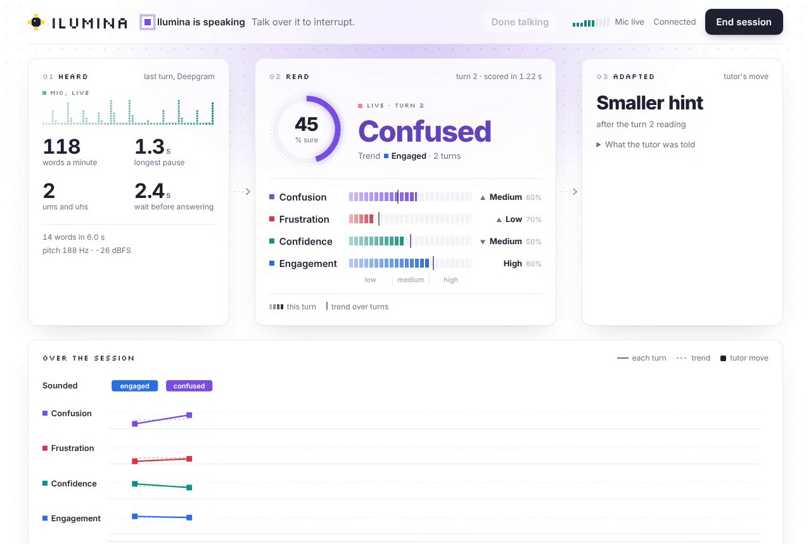
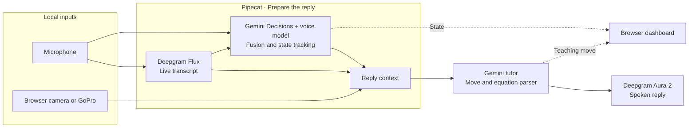

# Ilumina

**A voice tutor for math that adapts its hints and explanations to how a student sounds.**

Built at VexoHacks. Talk through a problem, point an optional camera at your work, and see the tutor’s latest reading and teaching move in the browser.

[Run locally](#run-locally) · [How a turn works](#how-a-turn-works) · [Lecture capture](#lecture-capture) · [Hosting](docs/hosting.md) · [Changelog](CHANGELOG.md)



*Sample turn data replayed through the dashboard. It shows what was heard, how the turn was scored, and which teaching move the tutor selected. [Full dashboard view](docs/dashboard/desktop.png)*

## What you can do

| During a tutoring session | Between sessions |
| --- | --- |
| **Work through math aloud.** Ilumina can give a smaller hint, try another explanation, or raise the difficulty. The dashboard can show its equations alongside the spoken reply. | **Capture a lecture.** Use a microphone, a recording, a Vexo band, or an existing transcript. Gemini turns the transcript into study notes. |
| **Show your work.** Point the browser camera or a local GoPro at a worksheet so the tutor can refer to a recent frame. | **Pick up where you left off.** Start a session from saved class notes, or generate a study plan from the notes and excerpts. |

## Run locally

Use Python 3.12 or newer, [uv](https://docs.astral.sh/uv/), a browser with microphone access, and internet access for Deepgram and Google Gemini.

```bash
git clone https://github.com/MeagerPotato/ilumina.git
cd ilumina
cp .env.example .env
```

Fill in `DEEPGRAM_API_KEY` and `GOOGLE_API_KEY` in `.env`. The Google key needs access to both the tutor model and the Decisions API for scoring.

```bash
uv sync --locked --python 3.12
uv run --locked bot.py
```

1. Open [the Ilumina dashboard](http://localhost:7860/dashboard/), select **Start session**, and allow microphone access. Headphones help keep the tutor’s audio out of your microphone.
2. Say “I’m solving two x plus three equals eleven,” then try the tutor’s next step aloud. **Heard** shows speech measurements, **Read** shows the latest estimate, and **Adapted** shows the teaching move. Use **Done talking** to end your turn manually. For a demo with people talking nearby, turn on **Push to talk** in the header: Ilumina then hears only while you hold Space or the **Hold to talk** button, and letting go sends the turn.
3. To share your work, select **Turn camera on** and point it at the page before your next turn. Select **End session** when you’re done.

The runner also serves the [Pipecat test client](http://localhost:7860/client/).

### Configuration

Copy values into `.env` using the [example file](.env.example).

| Setting | Purpose | Default |
| --- | --- | --- |
| `DEEPGRAM_API_KEY` | Live transcription and speech synthesis, plus lecture transcription | Required for voice and lecture capture |
| `GOOGLE_API_KEY` | Tutor replies, Decisions scoring, lecture notes, and study plans | Required for model calls |
| `GOOGLE_MODEL` | Gemini model for tutoring and lecture tools | `gemini-4-hydrogen` |
| `DECISION_MODEL` | Gemini model for rubric scoring via the Decisions API | `gemini-decision-1` |
| `DEEPGRAM_VOICE_ID` | Deepgram Aura-2 voice | `aura-2-helena-en` |
| `ILUMINA_CAMERA` | Source for the tutor’s camera. Use `gopro` for a local USB GoPro. | `browser` |
| `GOPRO_IP` | Override automatic GoPro discovery | Automatic |
| `ILUMINA_SESSION_SECONDS` | Session time limit in seconds, used by the hosted dashboard | `0` (unlimited) |
| `ILUMINA_MEMORY` | Save short excerpts from turns flagged for high confusion or frustration when a session disconnects | `off` |

## How a turn works



1. [`bot.py`](bot.py) connects the local browser over SmallWebRTC and streams audio to Deepgram Flux. Flux returns the transcript and word timings.
2. [`emotion.py`](ilumina/emotion.py) scores the spoken audio and transcript separately through Gemini Decisions. In parallel with the tutoring flow, [`measured.py`](ilumina/measured.py) measures pace, pauses, pitch, and other acoustic features. A local voice model uses acoustic features to compare the turn with the speaker’s baseline.
3. [`fusion.py`](ilumina/fusion.py) combines the available channels, and [`state.py`](ilumina/state.py) updates the probabilities for confusion, frustration, confidence, engagement, and the overall learning state. The dashboard receives the raw reading, trend, and measurements in a `student_state` event.
4. [`processors.py`](ilumina/processors.py) adds a recent camera image when available and waits up to 400 ms for a fresh state note. On timeout, the reply proceeds with the existing context.
5. Gemini streams a reply guided by the [tutor prompt](ilumina/prompts.py). The parser sends the teaching move and optional LaTeX equation to the dashboard, then Deepgram Aura-2 speaks the reply text.

### Engineering decisions

| Decision | How it works and what it costs |
| --- | --- |
| **Score voice and words separately.** | The voice request uses audio and measured features. The words request uses transcript and conversation text. Fusion weights the voice more heavily and can use the available channels if one fails. The split adds a second provider request when text is available. |
| **Keep the trend separate from the latest reading.** | The Bayesian tracker folds in each turn’s evidence and uses different persistence for each state. Very short turns count less, and short spikes may stay classified as blips. This limits abrupt changes, at the cost of sometimes taking another turn to reflect a shift. |
| **Give the tutor a scoring deadline.** | The 400 ms wait bounds the delay the state injector adds to a reply. A late reading can still appear in the dashboard after the tutor has started replying. |
| **Keep the camera context to one frame.** | Pipecat requests roughly one frame per second. A context processor replaces the prior image and skips frames over two seconds old. This keeps the image context small, while the tutor can only see what was visible in the selected still. |

The research notes document the score weights, voice-model evaluation, and dashboard event fields. They also explain the non-commercial terms that apply to the bundled voice model’s training data. [Emotion research notes](docs/emotion-research.md)

## Lecture capture

On macOS, the first microphone recording may prompt you to give Terminal microphone access. For a lecture with other people, let them know before recording.

```bash
uv run --locked lecture.py record                         # Computer mic. Press Ctrl+C to finish.
uv run --locked lecture.py record --file class.m4a        # Replay an existing recording.
uv run --locked lecture.py record --band 42               # Use your Vexo band number.
uv run --locked lecture.py record --text class.txt        # Use an existing transcript.
uv run --locked lecture.py show                           # Inspect saved lecture and session context.
uv run --locked lecture.py plan --days 3                  # Generate a plan from saved memory.
```

[`vexo_band.py`](ilumina/vexo_band.py) encodes microphone or file audio into 16 kHz mono Opus packets and feeds them through Vexo Open’s simulated band transport. A real band supplies packets over Bluetooth to the same decoder. [`transcribe.py`](ilumina/transcribe.py) sends the audio to Deepgram Nova-3, then [`memory.py`](ilumina/memory.py) asks Gemini for notes, likely sticking points, and check questions. `--text` sends an existing transcript directly to Gemini.

The save prompt controls **local** storage. Deepgram receives the lecture audio and Gemini receives its transcript before the prompt. Accept the prompt or pass `--save` to store the transcript and notes under `memory/`. A study plan is written to `memory/study-plan.md`. Run `uv run --locked lecture.py forget` and confirm to delete this local memory.

### GoPro preview

The [GoPro LIT HERO utility](gopro/README.md) controls the USB preview over Open GoPro HTTP and uses FFmpeg to decode the stream. Run the utility for a standalone preview, or set `ILUMINA_CAMERA=gopro` in `.env`, restart the local bot, and use the dashboard’s camera button to share the GoPro feed with the tutor.

## Hosted demo setup

The Vercel configuration serves the landing page at `/`, the dashboard at `/app/`, and the Python bot at `/api/bot`. Starting a hosted session requires a passcode. Sessions run over a WebSocket with optional camera stills and a configurable time limit. See the [hosting guide](docs/hosting.md) for deployment and configuration.

## Source and checks

| Path | Responsibility |
| --- | --- |
| [`bot.py`](bot.py) | Pipecat pipeline, WebRTC transport, and session events |
| [`ilumina/`](ilumina/) | Rubrics, state tracking, camera and text processors, prompts, lecture input, and local memory |
| [`dashboard/`](dashboard/) | HTML and JavaScript UI with bundled Pipecat transports and KaTeX |
| [`lecture.py`](lecture.py) | Record, inspect, plan from, and delete lecture and tutoring memory |
| [`gopro/`](gopro/) | GoPro preview feed and software camera fixture |
| [`landing/`](landing/) and [`deploy/vercel/`](deploy/vercel/) | Landing page and hosted demo packaging |
| [`scripts/`](scripts/) | Voice-model training and evaluation |
| [`tests/`](tests/) | Scoring, state, audio, camera, teaching tags, lecture capture, and memory regression tests |

```bash
uv sync --locked --python 3.12
uv run --locked pytest -q
```

The tests exercise the Vexo simulator and use test doubles for cloud calls. See the [software camera check](gopro/README.md#testing-without-the-camera) for checking USB-preview decoding without a GoPro.

## Project status

Ilumina is a hackathon prototype. Voice readings are model estimates of how speech sounds. Sessions send audio to Deepgram for transcription, and separate audio and text requests to Google for scoring. The Gemini tutor receives conversation context and selected camera images when the camera is enabled. Local tutoring memory is opt-in.

The repository currently has no license file. Ask the maintainers about reuse terms.
